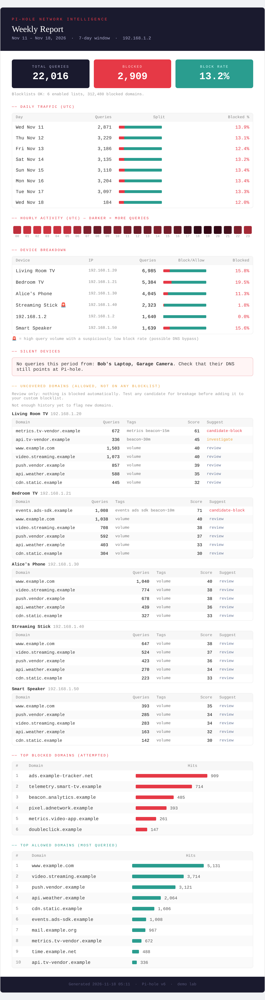

# pihole-network-intel

A weekly, emailed report on what your network is doing, built from Pi-hole's own query database. One small Python script, no extra services, no cloud.

Pi-hole's dashboard shows you the last few hours. This shows you the week: which devices are chatty, which ones are quietly bypassing your DNS, and which ones stopped talking to Pi-hole entirely.



*Sample report built from fake demo data (`--demo`), so no real devices or domains appear.*

## What's in the report

- **Summary:** total queries, blocked, block rate
- **Blocklist problem warning:** shown at the top (and in the email subject) when a blocklist fails to download, holds 0 domains, or the total number of blocked domains drops sharply
- **Daily traffic:** per-day volume and block rate, in your own timezone
- **Hourly activity:** 24-hour heat strip showing when the network is busy
- **Device breakdown:** queries and block rate per device, using friendly names from your config or the hostnames Pi-hole already learned
- **Possible DNS bypass 🚨:** devices with lots of queries but almost nothing blocked (smart TVs and phones hardcoding their own DNS or using DNS-over-HTTPS)
- **Silent devices:** devices you expect to see that sent no queries (their DNS setting probably reverted, e.g. after a reinstall or router change)
- **Uncovered domains:** per device, domains Pi-hole *allowed* that look like telemetry (a regular phone-home beat, telemetry-style names, third-party to the device's brand), as candidates for your own blocklist. Review-only: nothing is blocked automatically (see below)
- **Top blocked / top allowed domains**
- A plain-text copy saved to disk and attached as the text part of the email

Try it without touching your network: `python3 scripts/network_intel_report.py --demo` writes `demo-report.html` filled with fake data (that's how the screenshot above was made).

## Requirements

- Pi-hole **v6** (reads `/etc/pihole/pihole-FTL.db`)
- Python 3.8+ (standard library only)
- A Gmail account with an [app password](https://myaccount.google.com/apppasswords) if you want email delivery

## Quick start

```bash
git clone https://github.com/AdditiveCraftsman/pihole-network-intel.git
cd pihole-network-intel
cp config/config.example.py config/config.py
nano config/config.py                        # your IP, timezone, email, device names
python3 scripts/network_intel_report.py --no-email   # test without sending
```

Full setup, permissions and the cron job are in [INSTALL.md](INSTALL.md).

## How it counts

Blocked vs. allowed uses the status codes from the [Pi-hole query database docs](https://docs.pi-hole.net/database/query-database/): statuses 1, 4–11, 15, 16 and 18 count as blocked; 2, 3, 12–14 and 17 count as allowed. Block rates depend heavily on your blocklists and devices. A network full of smart TVs typically lands far lower than the percentages blocklist marketing quotes.

## Blocklist health

Pi-hole keeps running when a blocklist fails to download: it quietly uses an old copy, or none, and blocking gets weaker with no visible error. The report reads `gravity.db` (read-only) and warns about:

- enabled lists whose last download failed (`adlist.status` 3 = old copy used, 4 = no copy at all, per the [Pi-hole docs](https://docs.pi-hole.net/database/domain-database/))
- enabled lists holding 0 domains
- a fall of more than `BLOCKLIST_DROP_PCT` (default 20%) in the total blocked domains compared with the last good run

The last good count is kept in `reports/blocklist-health.json` and only moves up on a healthy run, so a drop keeps warning every week until it recovers. If you removed lists on purpose, accept the new count with `python3 scripts/blocklist_health.py reset`. A healthy run shows one quiet "Blocklists OK" line.

## Uncovered domains

Blocklists cover known-bad domains. What is left is specific to your devices: hosts they contact that no list covers. Each week the report lists, per device (grouped by MAC address, so a device that changes IP stays one device), the allowed domains that look like telemetry. "Uncovered" simply means the query log says the domain was allowed, so no blocklist matching is reimplemented.

Each row gets a score from volume, share of the device's traffic, beaconing (queries at regular intervals), novelty (not seen before the window), telemetry-style name tokens, and whether the domain is first- or third-party to the device's brand. The suggestion is one of:

- **candidate-block**: a telemetry-style name, or a regular beat that is also third-party or new
- **investigate**: a regular beat or telemetry-style name, but not enough to propose blocking (first-party beacons stay here so OS-critical hosts are not proposed)
- **keep**: everything else (CSV only)

Volume, "third-party" or "new" alone never flags a domain. General-purpose machines (laptops, phones) are noisy here because web apps poll on a timer, so list them in `UNCOVERED_SKIP` and keep the section focused on appliances. Domains on the built-in needed list (connectivity checks, OS update servers, Netflix core, time sync; extend it with `NEEDED_DOMAINS`) are never suggested.

Files written to `reports/uncovered/` (git-ignored, because they contain your device names):

| File | Purpose |
|------|---------|
| `candidates.txt` | one domain per line, **not applied automatically** |
| `uncovered-YYYY-MM-DD.csv` | every finding with score, tags and action |
| `reviewed.json` | your decisions, so reviewed domains stop repeating |

Workflow: read the email, test a candidate for breakage on the device (does the app still work?), then either record a decision

```bash
python3 scripts/uncovered_domains.py review us.example.com keep "TV needs it for the store"
python3 scripts/uncovered_domains.py review tracker.example.com block
```

or apply a block: append the domain to your custom blocklist and rebuild gravity (`sudo pihole -g`). To roll back, remove the line and rebuild. Pi-hole plain-domain lists match **exact hostnames only**, so list each hostname you want blocked. Reviewed `keep` and `block` decisions also cover subdomains of the domain you recorded.

Limitations: scoring is a heuristic tuned on one smart-TV network, not a verdict. "Family" grouping uses a small built-in list of multi-part suffixes, and novelty only looks back as far as Pi-hole's database retention (91 days by default).

## Tests

```bash
python3 -m unittest discover -s tests -v
```

The tests build a throwaway SQLite database with Pi-hole v6's table layout and synthetic smart-TV traffic. No real data is involved.

## Security notes

- The database is opened **read-only**.
- Your real settings live in `config/config.py`, which is git-ignored. You can leave the Gmail app password out of the file and set the `NETINTEL_GMAIL_PASSWORD` environment variable instead.
- If you ever commit a password by mistake, revoke it in your Google account right away; deleting it from git history later is not enough.

## Roadmap / contributions welcome

- Other delivery options (ntfy, Telegram, Discord webhook, local HTML only)
- Week-over-week deltas and "new device appeared" alerts
- Pi-hole v5 support

Issues and pull requests are welcome. Please keep the script dependency-free where you can.

## License

MIT, see [LICENSE](LICENSE).
